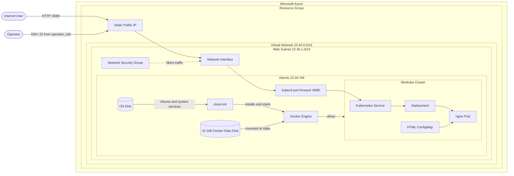
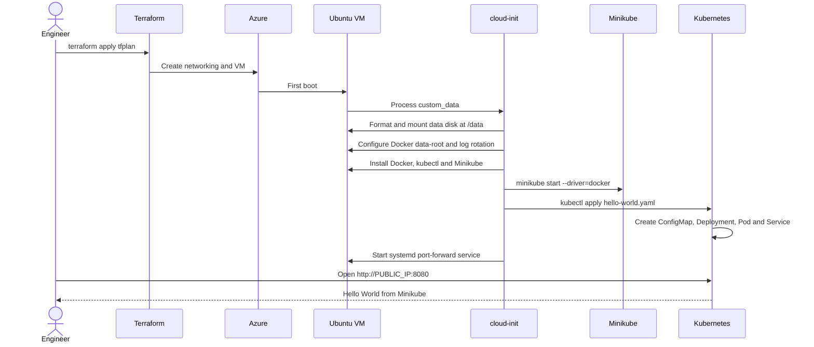

# Azure Terraform + Cloud-Init + Minikube Lab

<p align="center">
  
  
  
  
  
  
</p>

This portfolio lab provisions a small Ubuntu VM and its Azure networking with Terraform. During the VM's first boot, cloud-init installs Docker, Minikube and kubectl, starts a single-node Kubernetes cluster and deploys a containerized Hello World website.

The website is reached through the VM's public IP on port `8080`:

```text
Browser -> Azure Public IP:8080 -> kubectl port-forward
        -> Kubernetes Service -> nginx Pod -> Hello World page
```

## What this project demonstrates

- Azure infrastructure provisioning with Terraform.
- VNet, subnet, NSG, public IP and Linux VM networking.
- First-boot automation with cloud-init.
- Docker as the Minikube driver on Linux.
- A dedicated Azure managed disk for Docker and Minikube data.
- Persistent disk mounting by filesystem UUID.
- Docker log rotation to limit container log growth.
- A single-node Kubernetes cluster created without nested virtualization.
- Declarative Kubernetes resources: ConfigMap, Deployment and Service.
- Readiness and liveness probes.
- A systemd-managed process exposing the Kubernetes Service to the browser.
- SSH key authentication with source-IP restriction.

## Architecture



## First-boot automation



## Components

| Component | Responsibility |
|---|---|
| Terraform | Creates the Azure infrastructure and passes cloud-init as VM custom data. |
| Resource Group | Groups the lab resources for management and cleanup. |
| Virtual Network and subnet | Provide private networking for the VM. |
| Network Security Group | Allows HTTP `8080` publicly and SSH `22` only from `operator_cidr`. |
| Public IP and NIC | Connect Internet traffic to the VM. |
| Ubuntu VM | Hosts Docker and the local Kubernetes cluster. |
| OS disk | Stores Ubuntu, SSH, cloud-init and system services. |
| Docker data disk | Stores Docker images, containers and the Minikube node under `/data/docker`. |
| cloud-init | Performs the complete first-boot software configuration. |
| Docker | Runs the Minikube node container. |
| Minikube | Creates a learning-focused single-node Kubernetes cluster. |
| kubectl | Applies the manifests and forwards VM port `8080` to the Service. |
| ConfigMap | Stores the Hello World HTML page. |
| Deployment | Maintains the desired nginx Pod. |
| Service | Provides a stable endpoint for the nginx Pod inside Kubernetes. |
| systemd | Restarts the port-forward process if it exits or the VM reboots. |

## Repository structure

```text
azure-cloud-init-docker-hello-lab/
|-- cloud-init.yaml
|-- terraform.tf
|-- variables.tf
|-- outputs.tf
|-- terraform.tfvars.example
|-- azurerm.resource_group.lab.tf
|-- azurerm.virtual_network.lab.tf
|-- azurerm.subnet.web.tf
|-- azurerm.network_security_group.web.tf
|-- azurerm.subnet_network_security_group_association.web.tf
|-- azurerm.public_ip.vm.tf
|-- azurerm.network_interface.vm.tf
|-- azurerm.linux_virtual_machine.web.tf
|-- azurerm.managed_disk.docker.tf
|-- azurerm.virtual_machine_data_disk_attachment.docker.tf
|-- .gitignore
`-- README.md
```

Terraform treats all `.tf` files in this directory as one root module. Resource references determine creation order; filenames only keep the project readable.

## Prerequisites

- Azure subscription and Azure CLI authentication.
- Terraform.
- OpenSSH client and an SSH key pair.
- Permission to create resource groups, networking and virtual machines.

```powershell
az login
az account show -o table
```

## Configuration

Create an SSH key if needed:

```powershell
ssh-keygen -t ed25519 -f $HOME\.ssh\azure_cloudinit_lab
```

Copy the example configuration:

```powershell
Copy-Item .\terraform.tfvars.example .\terraform.tfvars
```

Retrieve the values:

```powershell
az account show --query "{subscription:id, tenant:tenantId}" -o table
(Invoke-RestMethod -Uri "https://api.ipify.org") + "/32"
Get-Content $HOME\.ssh\id_ed25519.pub
```

If the SSH public key ends with a Windows comment containing a backslash, copy only the key type and key value:

```hcl
admin_ssh_public_key = "ssh-ed25519 AAAAC3..."
```

Never commit `terraform.tfvars`, private SSH keys, state files or saved plans.

## Deployment

```powershell
terraform init
terraform fmt -check -recursive
terraform validate
terraform plan -out=tfplan
terraform apply tfplan
```

Cloud-init needs several minutes to download the Kubernetes components and container images. Obtain the URL after apply:

```powershell
$url = terraform output -raw website_url
$url
Start-Process $url
```

Expected URL format:

```text
http://PUBLIC_IP:8080
```

## Verify the cluster

Connect to the VM:

```powershell
$ip = terraform output -raw public_ip_address
ssh -i $HOME\.ssh\id_ed25519 azureadmin@$ip
```

Run these commands inside Ubuntu:

```bash
cloud-init status --wait
lsblk -f
findmnt /data
docker info --format '{{.DockerRootDir}}'
minikube status
kubectl get nodes
kubectl get deployments
kubectl get pods -o wide
kubectl get services
kubectl describe deployment hello-world
curl http://localhost:8080
```

Expected high-level state:

```text
/data mounted from the LUN 0 managed disk
Docker Root Dir: /data/docker
minikube node: Ready
hello-world deployment: 1/1 available
hello-world Pod: Running and Ready
hello-world Service: ClusterIP
```

## How the web request reaches the Pod

The Minikube Docker network is internal to the VM. The systemd unit keeps this command running:

```bash
kubectl port-forward --address=0.0.0.0 service/hello-world 8080:80
```

This maps the VM's port `8080` to port `80` of the Kubernetes Service. It is a simple lab technique for demonstrating the request path. Production Kubernetes platforms normally use an Ingress controller or a cloud LoadBalancer Service.

## Troubleshooting

Check cloud-init:

```bash
sudo cloud-init status --long
sudo tail -n 200 /var/log/cloud-init-output.log
```

Check Docker and Minikube:

```bash
sudo systemctl status docker --no-pager
df -h / /data
findmnt /data
docker info --format '{{.DockerRootDir}}'
docker system df
docker ps
minikube status
minikube logs --problems
```

Check Kubernetes:

```bash
kubectl get all
kubectl describe pod -l app=hello-world
kubectl logs deployment/hello-world
```

Check the public port-forward:

```bash
sudo systemctl status hello-world-port-forward --no-pager
sudo journalctl -u hello-world-port-forward -n 100 --no-pager
curl http://localhost:8080
```

From Windows:

```powershell
$ip = terraform output -raw public_ip_address
Test-NetConnection $ip -Port 8080
Invoke-WebRequest "http://$ip`:8080"
```

## Security and scope

- VM password authentication is disabled.
- SSH is restricted to the operator's `/32` public IP.
- Port `8080` is public for the portfolio demonstration.
- The Kubernetes API is not exposed to the Internet.
- Docker data is isolated from the OS disk and container logs are rotated.
- The NSG is associated before the VM is created.
- The Kubernetes cluster is for learning and portfolio demonstration, not production hosting.

## Azure for Students choices

- Denmark East, based on the previously observed subscription policy.
- `Standard_B2as_v2`: 2 vCPUs and 8 GiB RAM, enough for this small Minikube lab.
- Minikube uses the Docker driver, so nested virtualization is not required.
- One VM, one Standard LRS OS disk and one 32 GiB Standard LRS data disk; no AKS, Bastion, NAT Gateway or paid monitoring workspace.

Policy, quota and capacity can change. Review every Terraform plan before applying. The VM, both disks and public IP consume Azure credits until destroyed.

## Storage isolation

The OS disk contains Ubuntu and the tools required to administer the VM. A separate managed disk is attached at LUN 0, formatted as `ext4` and mounted persistently at `/data` by filesystem UUID. Docker uses `/data/docker` as its `data-root`, so Minikube images and container layers do not consume the root filesystem.

```text
OS disk                      Data disk
/                            /data
|-- Ubuntu                   `-- docker
|-- SSH                          |-- images
|-- cloud-init                   |-- containers
|-- systemd                      `-- Minikube node data
`-- system logs
```

The separation keeps the operating system manageable if Docker storage becomes full. It does not make storage unlimited: a full data disk can still stop image pulls, Pods and Minikube. Monitor it with `df -h /data` and `docker system df`. Docker's JSON logs are limited to three 10 MiB files per container.

## Cleanup

```powershell
terraform plan -destroy -out=destroy.tfplan
terraform apply destroy.tfplan
```

## Project status

The configuration is prepared for static validation. If infrastructure was created from an earlier version of this lab, create and inspect a fresh plan because changing VM `custom_data` normally requires replacing the VM.

## References

- [Minikube: Docker driver](https://minikube.sigs.k8s.io/docs/reference/drivers/docker/)
- [Minikube: Getting started](https://minikube.sigs.k8s.io/docs/start/)
- [Kubernetes: Install kubectl on Linux](https://kubernetes.io/docs/tasks/tools/install-kubectl-linux/)
